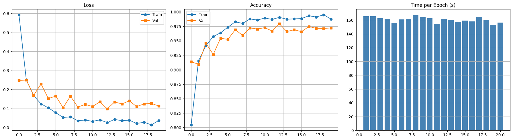
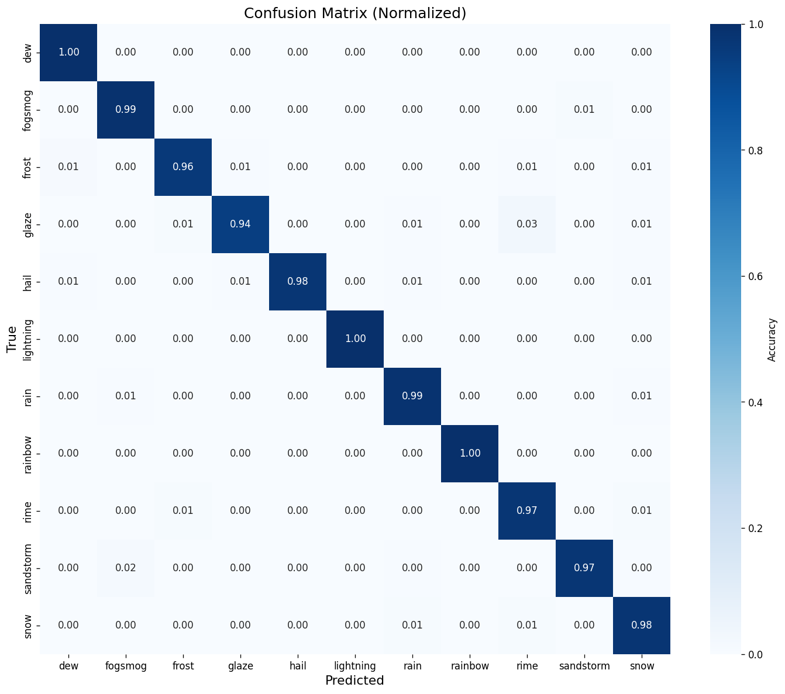
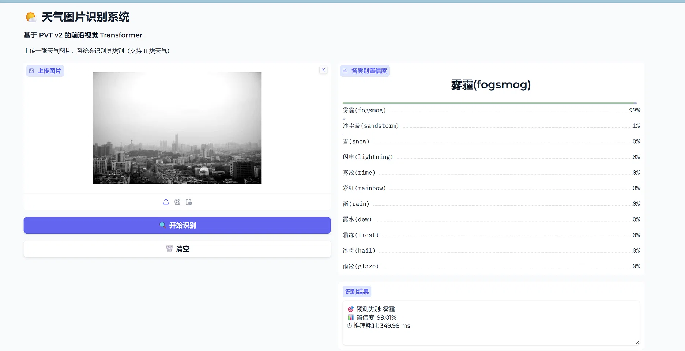

# 🌤️ 基于 PVT v2 的十一类天气图像识别系统

本项目是一个基于前沿视觉 Transformer 网络 **PVT v2** 和 **PaddlePaddle** 框架的 11 类天气图像分类系统。从数据处理、模型训练到 Web 端可视化部署提供完整全流程。

## 📊 项目成果

- **模型精度**：Accuracy **97.94%** / Precision **98.15%**
- **推理速度**：单张图像推理仅需 **~7ms** (RTX 4050)
- **数据压缩**：编写离线压缩脚本，将原始数据集从 1.2GB 缩减至 92MB（压缩率 92.4%）
- **覆盖类别**：露水, 雾霾, 霜冻, 雨凇, 冰雹, 闪电, 雨, 彩虹, 雾凇, 沙尘暴, 雪

## ✨ 核心特性

1. **前沿模型**：采用 PVT v2 (B2-Linear) 架构，兼具 Transformer 的全局感受野与 CNN 的轻量化。
2. **丰富的特征增强**：针对天气特点设计了 7 种数据增强（缩放裁剪、翻转、旋转、色彩抖动、高斯模糊模拟雾天、Cutout 遮挡）。
3. **显存优化**：在仅 6GB 显存的 RTX 4050 上，引入 AMP（自动混合精度）与余弦退火策略，确保训练稳定高效。
4. **Web 可视化部署**：集成 Gradio 框架，支持图片拖拽上传、实时分类与置信度条展示。

## 🖼️ 界面展示





## 🚀 快速开始

### 1. 环境安装
```bash
pip install -r requirements.txt
